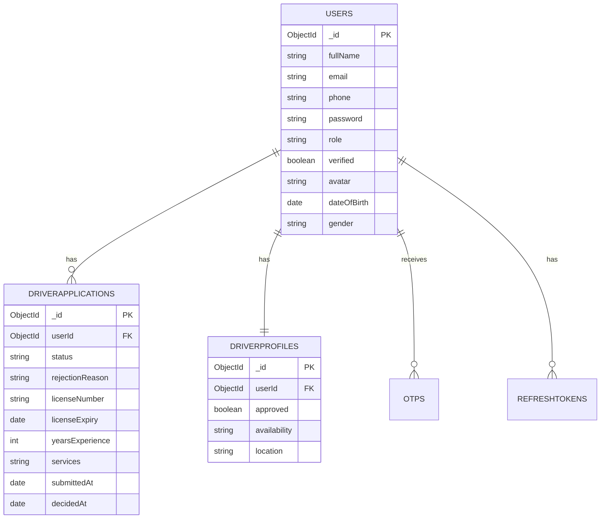
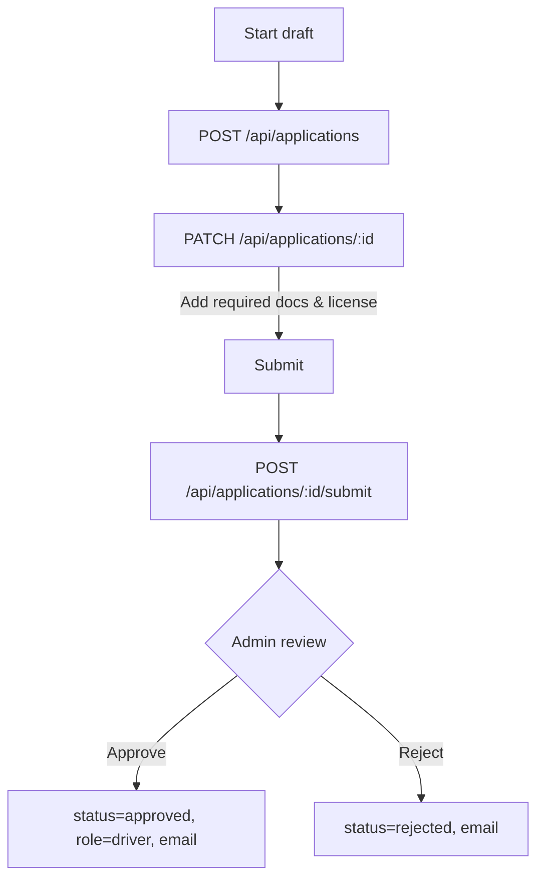
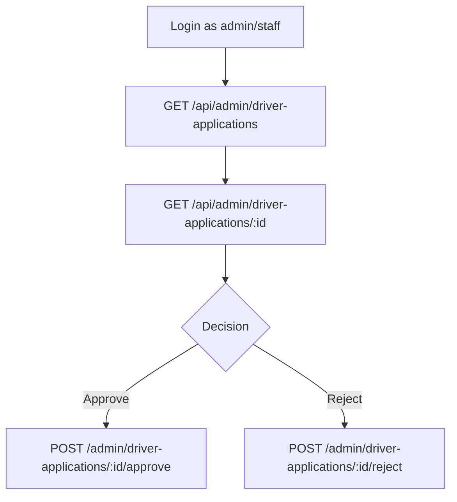
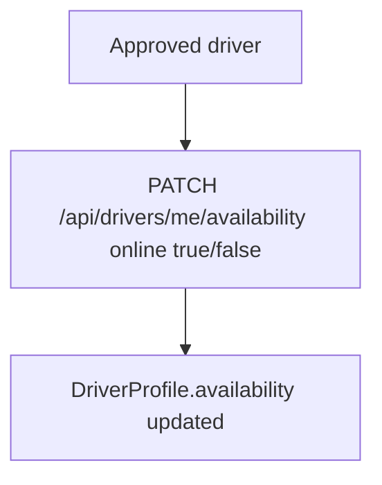

Task 1 v1 — Driver Registration & Review (Backend)

Date: 2025-09-30

## Overview
- Goal: Allow users to register as drivers, submit applications with required data and documents, support admin/staff review, and manage approved drivers’ availability.
- Stack: Node.js (Express), MongoDB (Mongoose), JWT auth, Nodemailer.

## Data Model Summary

Entities and relationships:
- `users` 1 — 0..1 `driverprofiles`
- `users` 1 — 0..* `driverapplications`
- `users` 1 — 0..* `otps`
- `users` 1 — 0..* `refreshtokens`

## Key Requirements Implemented

- Personal info (required): fullName, phone, email, idNumber (CCCD/CMND)
- Vehicle info (required): type, brand, model, year, plate, color
- Driver info (required): licenseNumber, licenseExpiry, yearsExperience (>=0), services (≥1 of: drive_by_hour, city_service, long_distance, interprovincial_tourism, vip, premium_clients, airport_pickup, airport_specialist)
- Documents (required for submission): idFrontUrl, idBackUrl, driverLicenseFrontUrl, driverLicenseBackUrl
- Application status flow: draft → pending → approved/rejected
- Approval side-effects: email approval + set `users.role = "driver"`, `driverprofiles.approved = true`
- Rejection side-effects: email rejection with reason, profile approved=false, availability=offline
- Edit constraints: update/delete/submit only when status=draft; immutable after decision

## API Endpoints (Final)

Base: `/api`

User-facing (authenticated, verified users):
- POST `/api/applications` — create new draft (201) or update with `applicationId` (200)
- GET `/api/applications/me` — list all my applications (newest first)
- PATCH `/api/applications/{id}` — update a draft by id
- DELETE `/api/applications/{id}` — delete a draft by id
- POST `/api/applications/{id}/submit` — submit a draft for review (validates required docs + license fields)
- PATCH `/api/drivers/me/availability` — toggle availability (role=driver, approved only)

Admin/Staff (role-based):
- GET `/api/admin/driver-applications?status=&search=&page=&limit=&createdFrom=&createdTo=&yearsMin=&yearsMax=&services=`
- GET `/api/admin/driver-applications/{id}`
- POST `/api/admin/driver-applications/{id}/approve` — promotes user to driver, emails user
- POST `/api/admin/driver-applications/{id}/reject` — emails rejection reason

## Validation

Draft create/update requires: personal, vehicle, licenseNumber, licenseExpiry, yearsExperience, services.
Submit requires: draft status, 4 document URLs, license fields present, yearsExperience >= 0, ≥1 service.
IDs validated as ObjectId; ownership enforced for user routes; RBAC enforced for admin/staff routes.

## Notifications

- On submit: acknowledgment email
- On approve: approval email + role change to driver
- On reject: rejection email with reason

## CORS & Auth

- CORS allowlist via `CORS_ORIGIN` (comma-separated); preflights handled
- JWT auth via Bearer; `authorizeRoles` middleware on restricted routes

## Swagger Docs

- Tag: Driver Application
- Schemas reflect required draft fields and document requirements
- Examples provided for create/update draft with required fields

## Notes & Risks

- Multiple applications per user allowed; GET `/me` returns all
- Submit/update/delete restricted to draft status; approved/rejected immutable
- Ensure `SWAGGER_URL` set for accurate server URL
- File storage out of scope: API expects URLs

## Acceptance Summary

- Users can create, edit, delete drafts; submit to pending; see all their applications
- Admin/staff can list, view, approve/reject; approval promotes role to driver
- Approved drivers can toggle availability; non-approved cannot

## Workflows (Mermaid)

### User Application Workflow

### Admin/Staff Review Workflow

### Driver Availability Workflow

## Screen Flows (FE reference)

- Driver registration multi-step:
  - Personal ➜ Vehicle ➜ Documents ➜ Review ➜ Status
- Status screen shows: pending/approved/rejected (with reason)
- Approved users see a driver-mode toggle to go online/offline

